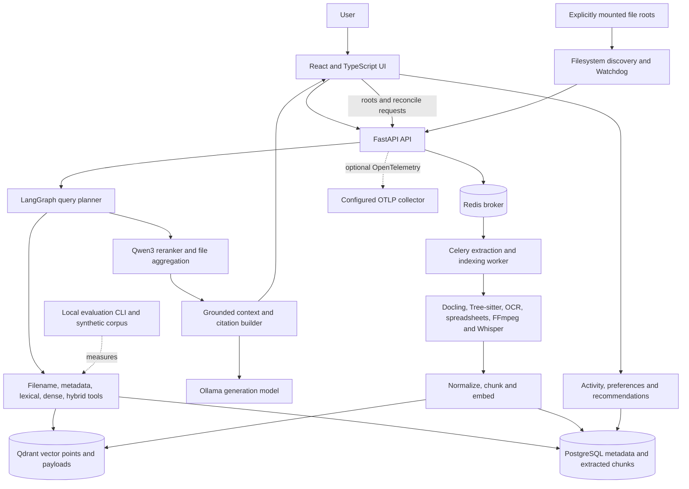
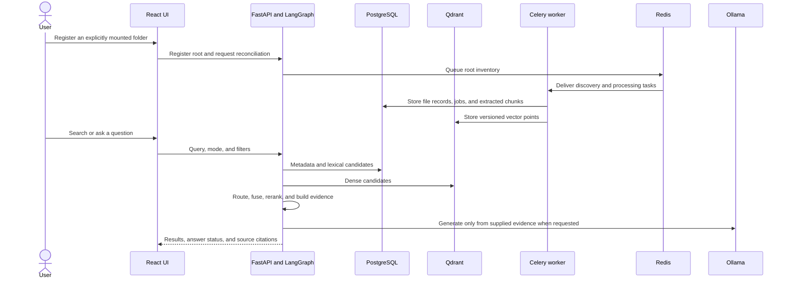

# ScoutX

ScoutX is a local-first file discovery application. It indexes only folders a
user explicitly registers, then combines metadata, lexical, and semantic
retrieval to find files and answer questions with source references.

The problem it addresses is finding useful material across a mixed personal
work library when the query does not match a filename. ScoutX extracts text
from supported documents, code, spreadsheets, images, and media; it stores
metadata and extracted chunks in PostgreSQL and vector references in Qdrant.
Original files stay in their registered folders.

## Capabilities

- Explicit folder registration, recursive discovery, hashing, incremental
  Watchdog monitoring, and periodic reconciliation.
- Extraction for office documents and PDFs, source code, CSV/XLSX, images with
  OCR, and audio/video transcripts when optional system/model dependencies are
  available.
- PostgreSQL-backed file metadata and extracted evidence, Qdrant dense vectors,
  lexical and metadata retrieval, hybrid ranking, and reciprocal rank fusion.
- LangGraph query planning, bounded retrieval tools, Qwen reranking, and
  optional Ollama grounded answers with citations.
- File details, indexing status, feedback, activity, preferences, profiles,
  and recommendations in the React interface and API.
- Versioned synthetic evaluation data, deterministic ranking metrics, artifact
  ingestion, comparisons, and reports.

The current API is a single-user, local-development application. It does not
provide network user authentication. Keep it bound to loopback and do not expose
it through a public proxy or tunnel.

## Architecture



The request, ingestion, and personalization boundaries are described in
[Architecture](docs/ARCHITECTURE.md). OpenTelemetry export is opt-in; Compose
does not start an external collector.

## Quick start with Docker Compose

Docker Engine with the Compose v2 plugin is required. The supported Compose
setup builds local API, worker, and frontend images and starts PostgreSQL,
Qdrant, Redis, and Ollama. All host-published ports bind to loopback.

```sh
cp .env.example .env
openssl rand -hex 24
# Put the generated value in POSTGRES_PASSWORD in .env.
docker compose up --build -d
docker compose ps
docker compose logs -f backend worker
```

The backend container applies Alembic migrations before starting the API. Pull
the default configured generation model once; this is deliberately not an
automatic startup action. If you override `SCOUTX_OLLAMA_MODEL`, pull that
identifier instead:

```sh
docker compose exec ollama ollama pull qwen3:8b
```

Open <http://127.0.0.1:5173>. In Settings, register `/demo/sample-files`; then
open Indexing and select **Reconcile**. Wait until indexing finishes before
trying the queries in [the demo walkthrough](docs/DEMO.md). The embedding and
reranker weights are loaded from their configured Hugging Face model IDs on
first use and cached in a persistent Docker volume. Model download and inference
have not been verified on every hardware platform.

To stop the services without deleting data, run `docker compose down`. Do not
use `docker compose down -v` unless you intentionally want to remove local
database and model data.

## Local development

Use Python 3.12, uv, Node.js 22+, npm, PostgreSQL 18, Qdrant, Redis, libmagic,
FFmpeg, and Java for the optional Tika fallback. Install the extraction and
embedding extras when developing those integrations:

```sh
docker compose up -d postgres qdrant redis ollama
cd backend
uv sync --extra extraction --extra embedding --group dev
cp .env.example .env
# Set DATABASE_URL to match the PostgreSQL credentials in the root .env.
uv run alembic upgrade head
uv run uvicorn app.main:app --reload --host 127.0.0.1 --port 8000
```

In another terminal:

```sh
cd frontend
npm ci
cp .env.example .env.local
npm run dev
```

Run a Celery worker and its periodic reconciler from `backend/` in separate
terminals:

```sh
uv run celery -A app.workers.celery_app:celery_app worker --loglevel=INFO
uv run celery -A app.workers.celery_app:celery_app beat --loglevel=INFO
```

Local development starts the dependencies in containers and the application
processes on the host. See [Installation](docs/INSTALLATION.md) for setup and
the test commands.

## Main workflow



## Search and question answering

Use the Search page to choose automatic, keyword, semantic, or hybrid retrieval.
Search-only requests do not need answer generation; RAG answers can degrade
when Ollama or its model is unavailable. Citations point to chunks persisted in
PostgreSQL and retain available page, line, sheet, or timestamp provenance.
Review file details and supporting snippets in the interface.

## Personalization and recommendations

Opening files, search interactions, and submitted feedback contribute to the
local activity history. The Settings page controls personalization and file
type/root preferences. Recommendations are derived from the indexed library
and available activity; a cold-start profile is expected for a new workspace.

## API and health

FastAPI OpenAPI is available at <http://127.0.0.1:8000/docs> when using the
local API process. Main routes include `/api/v1/search`, `/api/v1/files`,
`/api/v1/roots`, `/api/v1/indexing/status`, `/api/v1/index/reconcile`,
`/api/v1/recommendations`, `/api/v1/personalization`, and `/api/v1/feedback`.
Health probes are `/api/v1/live`, `/api/v1/ready`, and `/api/v1/health`.
Endpoint details and limits are in [API reference](docs/API.md).

## Evaluation

Run the deterministic synthetic evaluation from `backend/`:

```sh
uv run python -m evaluation.cli --mode all --output-dir evaluation/results
```

The default retrieval run measures an offline token-overlap baseline, not live
ScoutX search. Model-based and integration measurements require an explicit
provider or captured artifact. See [Evaluation](docs/EVALUATION.md) and
`backend/evaluation/README.md`.

## Security and privacy

- Register only folders the operator intends to index. Docker can read a host
  root only when it is explicitly bind-mounted; the sample mount is read-only.
- The API is single-user and local-only; Compose publishes ports on `127.0.0.1`.
- Never add private libraries, model weights, local databases, or `.env` files
  to Git. Original files are never copied into Qdrant.
- Parser and model dependencies are optional in lightweight development
  environments. Use a non-root process and inspect the scope of mounted roots.

See [Security](docs/SECURITY.md), [Deployment and backup](docs/DEPLOYMENT.md),
and [Troubleshooting](docs/TROUBLESHOOTING.md).

## Known limitations

- ScoutX is currently a local, single-user app without network authentication or
  multi-user isolation; it is not suitable for public exposure.
- OCR, document parsing, embeddings, reranking, and media transcription need
  optional packages and/or model downloads. These live pipelines were not all
  run in this environment.
- The checked-in evaluation corpus is small and synthetic. Its default ranking
  baseline is offline token overlap, not a production retrieval result.
- Ragas integration, a Prometheus `/metrics` endpoint, and container startup,
  migration, and end-to-end checks remain unverified here.

## Future enhancements

Possible future work, outside this finalization, includes a network
authentication provider, multi-user isolation, dedicated model lifecycle
management, and measured model-backed evaluation. These capabilities are not
part of the current application.

## Repository map

```text
backend/app/       API, database, ingestion, retrieval, agent and worker code
backend/migrations Alembic schema history
backend/tests/     backend unit and contract tests
backend/evaluation synthetic dataset, metrics, runner and reports
frontend/src/      React pages, components and API client
demo/sample-files  small synthetic multi-format demonstration corpus
docs/              installation, architecture, demo and release guides
docker-compose.yml local infrastructure and app orchestration
```

Known limitations, current verification status, and the release checklist are
in [docs/RELEASE_CHECKLIST.md](docs/RELEASE_CHECKLIST.md).
