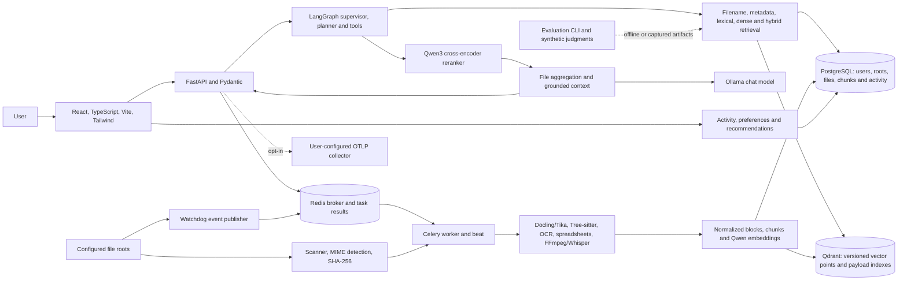
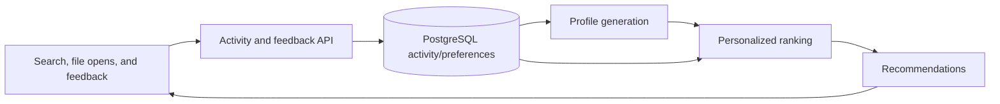

# Architecture and implementation boundaries

ScoutX is a local-first, single-user application. The repository's implemented
boundaries are shown below; optional models and external telemetry are not
required to import the lightweight API or run deterministic tests.

## Frontend and API

`frontend/src` contains the React interface, pages, API client, and component
tests. During Docker deployment, unprivileged Nginx serves the built frontend
and proxies `/api/` to FastAPI. Local development runs Vite and FastAPI on
loopback. The API single-user identity is a development workspace identity;
there is no network authentication provider.

FastAPI routes are grouped under `/api/v1`. Pydantic validates requests and
responses; SQLAlchemy sessions are request-scoped. The API does not migrate the
database on its own: local setup runs Alembic explicitly, and the Compose API
command runs `alembic upgrade head` before Uvicorn. Migration errors stop API
startup.

## Discovery and indexing

Users register canonical directories through the roots API. The scanner
recursively enumerates allowed roots, identifies content by MIME signature,
hashes data, and updates PostgreSQL file/version records. Watchdog translates
changes into debounced Celery messages. Root observers are attached on
registration and when the roots page is loaded; they stop on root removal and
API shutdown. Periodic Celery beat reconciliation provides a catch-up path.

The worker runs parser selection, normalization, chunking, embeddings, and
version-safe index activation. Docling handles structured documents when the
optional extraction dependencies are installed; Tika is a fallback. Source
code uses Tree-sitter grammars with text fallback. Image OCR, office formats,
and audio/video transcription need their corresponding optional packages and
external model assets. Original file contents remain in the registered source
folder. PostgreSQL stores extracted chunk text; Qdrant stores vectors and
references.

## Retrieval, agent, and RAG

The LangGraph supervisor routes an intent to user-scoped filename, metadata,
lexical, semantic, or hybrid retrieval tools. Hybrid mode combines lexical and
dense candidates with reciprocal rank fusion. The Qwen3 reranker can use a
bounded fallback ranking if configured. Results are aggregated by file;
grounded context uses persisted chunks and builds citation locations. Ollama
generates an answer only from that context. If evidence is insufficient or
generation is unavailable, the API returns a bounded status/fallback.

## Personalization and evaluation

File activity, explicit feedback, user preferences, profiles, and
recommendations are implemented in `backend/app/personalization` and exposed
through API routes. The offline evaluation CLI validates a synthetic dataset,
computes deterministic ranking and related metrics, accepts captured service
artifacts, and writes reports. Its default synthetic token-overlap run is not
production search. Ragas-based evaluation is not implemented in this repository.

## Infrastructure and observability

PostgreSQL is the canonical relational store; Qdrant stores vector points;
Redis brokers Celery tasks; Ollama serves the configured generation model.
Celery beat schedules root reconciliation. Structured logs and health endpoints
are implemented. OpenTelemetry tracing and metrics export is opt-in and requires
a collector configured by the operator; ScoutX does not include a collector or
a Prometheus `/metrics` route by default.
